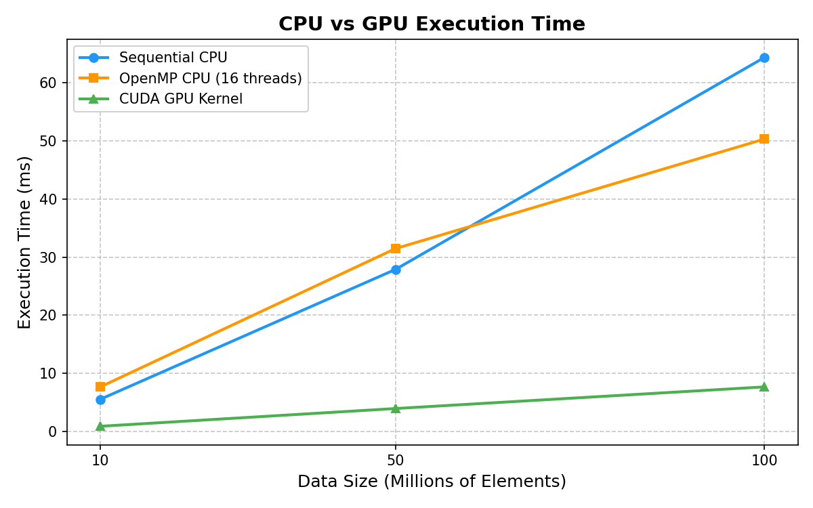
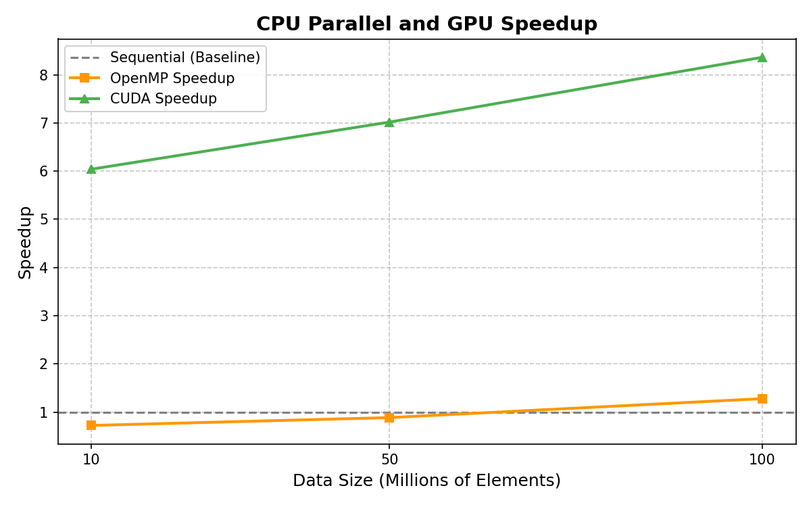
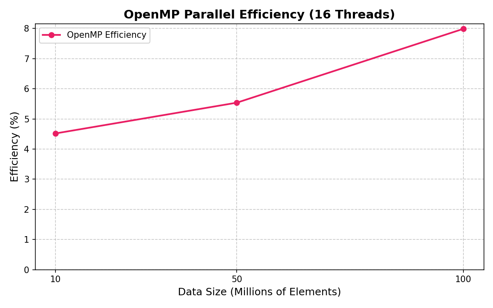

# CPU vs GPU Data Processing

**Topic 10 — CPU vs GPU Data Processing**
**Subject:** Parallel Computing
**Parallel Model:** OpenMP + CUDA

---

## 1. Team Members

| Name | Roll Number |
|------|-------------|
| ___________________ | ___________________ |
| ___________________ | ___________________ |
| ___________________ | ___________________ |
| ___________________ | ___________________ |

> *Fill in team member names and roll numbers before submission.*

---

## 2. Problem Definition

This project performs the **same numerical operation** (vector addition) using three different execution strategies:

1. **Sequential CPU** — single-threaded execution on the CPU
2. **OpenMP CPU** — multi-threaded parallel execution on the CPU using OpenMP
3. **CUDA GPU** — massively parallel execution on the GPU using NVIDIA CUDA

The goal is to compare the execution time, speedup, and parallel efficiency of each approach across increasing data sizes (10 million, 50 million, and 100 million elements).

---

## 3. Objective

- Establish a **CPU sequential baseline** for performance comparison.
- Parallelize the operation across CPU threads using **OpenMP**.
- Offload the operation to the GPU using **CUDA**.
- Measure and compare **execution times** across all three methods.
- Calculate **speedup** relative to the sequential baseline.
- Calculate **parallel efficiency** for the OpenMP implementation.
- Analyze when parallelism provides real benefits and when overhead dominates.

---

## 4. Numerical Operation

The operation performed in all three implementations is **element-wise vector addition**:

```
C[i] = A[i] + B[i]
```

Where:
- `A[i] = 1.0` for all elements
- `B[i] = 2.0` for all elements
- Therefore, `C[i] = 3.0` for all elements

All verified runs produced **Result Check = 3**, confirming computational correctness across all methods.

---

## 5. Sequential Algorithm

The sequential implementation uses a single `for` loop running on one CPU thread:

```cpp
for (long long i = 0; i < N; i++) {
    C[i] = A[i] + B[i];
}
```

Timing is measured using `std::chrono::high_resolution_clock`.

This serves as the **baseline** for speedup and efficiency calculations.

---

## 6. OpenMP Parallel Design

The OpenMP implementation parallelizes the same loop using:

```cpp
omp_set_num_threads(threads);

#pragma omp parallel for
for (long long i = 0; i < N; i++) {
    C[i] = A[i] + B[i];
}
```

**How it works:**
- The `#pragma omp parallel for` directive distributes loop iterations across multiple CPU threads.
- Each thread processes a subset of the array independently.
- No data dependencies exist between iterations, making this an **embarrassingly parallel** workload.
- The number of threads is configurable via command-line argument (16 threads used in the final experiment).

---

## 7. CUDA Parallel Design

The CUDA implementation offloads the computation to the GPU:

```cpp
__global__ void vectorAdd(const float* A, const float* B, float* C, long long N) {
    long long i = (long long)blockIdx.x * blockDim.x + threadIdx.x;
    if (i < N)
        C[i] = A[i] + B[i];
}
```

**Key concepts:**
- **Kernel:** The `vectorAdd` function runs on the GPU. Each GPU thread computes one element of the result.
- **Thread index:** `blockIdx.x * blockDim.x + threadIdx.x` maps each thread to a unique array element.
- **Threads per block:** 256 (a standard choice that balances occupancy and register usage on modern GPUs).
- **Number of blocks:** `ceil(N / 256)` — enough blocks to cover all N elements.
- **Bounds checking:** The `if (i < N)` guard prevents out-of-bounds access when N is not a multiple of 256.
- **GPU used:** NVIDIA GeForce RTX 3050 (Ampere architecture, `sm_86`).

**Memory flow:**
1. Allocate host arrays and initialize data on CPU.
2. Allocate device arrays on GPU (`cudaMalloc`).
3. Copy input data from CPU to GPU (`cudaMemcpy`, Host → Device).
4. Launch the kernel.
5. Copy results from GPU to CPU (`cudaMemcpy`, Device → Host).
6. Free device memory.

**Timing:** CUDA events (`cudaEventRecord`, `cudaEventElapsedTime`) measure **kernel execution time only** — see [Section 15](#15-cuda-timing-limitation).

---

## 8. Hardware and Software

| Component | Details |
|-----------|---------|
| **CPU** | Intel Core i7-13650HX |
| **CPU Logical Processors** | 20 |
| **GPU** | NVIDIA GeForce RTX 3050 Laptop GPU |
| **GPU VRAM** | 6 GB |
| **OS** | Windows 11 |
| **CUDA Toolkit** | 13.4 |
| **CUDA Architecture** | sm_86 (Ampere) |
| **Compiler** | Microsoft Visual Studio Community 2026 |
| **OpenMP** | MSVC OpenMP (`/openmp:llvm`) |

---

## 9. Build Commands

All commands are run from the `src/` directory.

**Sequential CPU:**
```
cl /O2 sequential.cpp /Fe:sequential.exe
```

**OpenMP CPU:**
```
cl /O2 /openmp:llvm openmp.cpp /Fe:openmp.exe
```

**CUDA GPU:**
```
nvcc -O2 -arch=sm_86 cuda.cu -o cuda.exe
```

---

## 10. Run Commands

**Sequential CPU:**
```
sequential.exe 10000000
sequential.exe 50000000
sequential.exe 100000000
```

**OpenMP CPU (16 threads):**
```
openmp.exe 10000000 16
openmp.exe 50000000 16
openmp.exe 100000000 16
```

**CUDA GPU:**
```
cuda.exe 10000000
cuda.exe 50000000
cuda.exe 100000000
```

---

## 11. Results

### Sequential CPU

| Data Size | Execution Time (ms) | Execution Time (s) | Threads |
|-----------|---------------------|---------------------|---------|
| 10,000,000 | 5.5548 | 0.0055548 | 1 |
| 50,000,000 | 27.883 | 0.027883 | 1 |
| 100,000,000 | 64.338 | 0.064338 | 1 |

### OpenMP CPU (16 Threads)

| Data Size | Execution Time (ms) | Execution Time (s) | Threads |
|-----------|---------------------|---------------------|---------|
| 10,000,000 | 7.6805 | 0.0076805 | 16 |
| 50,000,000 | 31.4683 | 0.0314683 | 16 |
| 100,000,000 | 50.3049 | 0.0503049 | 16 |

### CUDA GPU Kernel

| Data Size | Kernel Time (ms) | Kernel Time (s) | Threads/Block | Blocks |
|-----------|-------------------|-------------------|---------------|--------|
| 10,000,000 | 0.919488 | 0.000919488 | 256 | 39,063 |
| 50,000,000 | 3.97248 | 0.00397248 | 256 | 195,313 |
| 100,000,000 | 7.69331 | 0.00769331 | 256 | 390,625 |

**Result Check:** All runs produced `C[N-1] = 3`, confirming correctness.

---

## 12. Speedup

**Speedup** measures how many times faster a parallel implementation is compared to the sequential baseline:

```
Speedup = Sequential Time / Parallel Time
```

| Data Size | Sequential (ms) | OpenMP (ms) | CUDA Kernel (ms) | OpenMP Speedup | CUDA Speedup |
|-----------|-----------------|-------------|-------------------|----------------|--------------|
| 10M | 5.5548 | 7.6805 | 0.919488 | 0.72 | 6.04 |
| 50M | 27.883 | 31.4683 | 3.97248 | 0.89 | 7.02 |
| 100M | 64.338 | 50.3049 | 7.69331 | 1.28 | 8.36 |

**Observations:**
- At 10M and 50M elements, OpenMP is **slower** than sequential (speedup < 1). The overhead of creating and managing 16 threads exceeds the benefit of parallelism for these data sizes with this simple operation.
- At 100M elements, OpenMP achieves a modest speedup of 1.28×, showing that parallelism begins to pay off for larger datasets.
- CUDA achieves significant speedup across all data sizes (6× to 8.4×), demonstrating the GPU's ability to process thousands of elements simultaneously.

---

## 13. Efficiency

**Parallel efficiency** measures how effectively the available processors are utilized:

```
Efficiency = (Speedup / Number of Threads) × 100%
```

### OpenMP Efficiency (16 Threads)

| Data Size | OpenMP Speedup | OpenMP Efficiency (%) |
|-----------|----------------|-----------------------|
| 10M | 0.72 | 4.52% |
| 50M | 0.89 | 5.54% |
| 100M | 1.28 | 7.99% |

**Observations:**
- OpenMP efficiency is low for this workload because vector addition is **memory-bound**, not compute-bound. Each element involves only one addition, so CPU threads spend most of their time waiting for data from memory rather than performing useful computation.
- The overhead of thread creation, synchronization, and cache management dominates at smaller data sizes.
- Efficiency improves with data size as the per-thread workload increases.

### Why GPU Efficiency Is Not Reported Using Raw CUDA Thread Count

For OpenMP, efficiency is computed as `Speedup / Threads` because the number of threads directly represents the number of independent processing units.

For CUDA, the situation is fundamentally different:
- A CUDA launch may use millions of threads (e.g., 100M elements = 390,625 blocks × 256 threads = ~100M threads).
- Dividing the speedup (8.36) by 100 million threads would yield a meaninglessly small number.
- CUDA threads are **not equivalent** to CPU threads. They are lightweight execution units organized into warps (32 threads), and the GPU has a fixed number of streaming multiprocessors (SMs) that schedule these warps.
- The GPU processes threads in hardware-managed batches — the thread count is a programming abstraction, not a direct measure of physical parallelism.

Therefore, GPU efficiency calculated as `Speedup / CUDA thread count` would be **misleading** and is not reported.

---

## 14. Graph Analysis

### Execution Time Comparison



- Execution time increases linearly with data size for all three methods.
- CUDA GPU kernel time is consistently the lowest, followed by sequential CPU, then OpenMP CPU (at smaller sizes).
- The gap between CUDA and CPU methods widens as data size increases.

### Speedup



- CUDA speedup increases with data size, reaching 8.36× at 100M elements. Larger datasets allow the GPU to better amortize launch overhead and keep its cores busy.
- OpenMP speedup is below 1.0 for 10M and 50M elements (thread overhead exceeds the computation), but crosses 1.0 at 100M elements.

### OpenMP Efficiency



- Efficiency increases with data size but remains under 8% even at 100M elements.
- This is expected for a memory-bound operation like vector addition — the bottleneck is memory bandwidth, not CPU compute.
- A more compute-intensive operation (e.g., matrix multiplication) would show much higher OpenMP efficiency.

---

## 15. CUDA Timing Limitation

> **Important:** The CUDA execution times reported in this project represent **kernel execution time only**.

The timing uses `cudaEventRecord()` placed immediately before and after the kernel launch:

```cpp
cudaEventRecord(start);
vectorAdd<<<blocks, threadsPerBlock>>>(d_A, d_B, d_C, N);
cudaEventRecord(stop);
cudaEventSynchronize(stop);
cudaEventElapsedTime(&milliseconds, start, stop);
```

**What is NOT included in the timing:**
- `cudaMalloc()` — GPU memory allocation
- `cudaMemcpy()` Host → Device — copying input arrays A and B to GPU
- `cudaMemcpy()` Device → Host — copying result array C back to CPU

In a real-world application, memory transfer time can be **significant** and may even dominate the total GPU execution time for simple operations like vector addition. The kernel-only time shows the raw computational advantage of the GPU but does not represent the total end-to-end cost of using the GPU.

---

## 16. Conclusion

This project demonstrates the performance characteristics of sequential CPU, OpenMP multi-threaded CPU, and CUDA GPU execution for a simple vector addition operation:

1. **CUDA GPU** provides the highest speedup (6× to 8.4× over sequential CPU) by leveraging thousands of parallel threads on the GPU. For memory-streaming workloads like vector addition, the GPU's high memory bandwidth is the primary advantage.

2. **OpenMP CPU** introduces thread management overhead that can make it **slower** than sequential execution for small or simple workloads. The benefit of OpenMP becomes visible only at larger data sizes (100M elements), where the per-thread workload justifies the parallelization overhead.

3. **Sequential CPU** serves as the baseline. Its performance is predictable and linear with data size.

4. **Vector addition** is an ideal candidate for GPU parallelism because:
   - There are no data dependencies between elements.
   - The operation is the same for every element (SIMD-friendly).
   - The workload scales linearly and maps naturally to GPU threads.

5. The CUDA timing measures kernel execution only. Including memory transfer would increase the total GPU time, but the kernel speedup demonstrates the raw parallel processing capability of the GPU hardware.

---

## Project Structure

```
CPU-VS-GPU-Data-Processing/
│
├── README.md
│
├── src/
│   ├── sequential.cpp             # Sequential CPU implementation
│   ├── openmp.cpp                 # OpenMP parallel CPU implementation
│   └── cuda.cu                    # CUDA GPU implementation
│
├── results/
│   ├── final_comparison.csv       # Raw experimental results
│   └── performance_analysis.csv   # Speedup and efficiency calculations
│
├── graphs/
│   ├── execution_time.png         # Execution time comparison graph
│   ├── speedup.png                # Speedup comparison graph
│   └── openmp_efficiency.png      # OpenMP efficiency graph
│
└── presentation/
    └── CPU_vs_GPU.pptx            # Project presentation (to be added)
```

---
